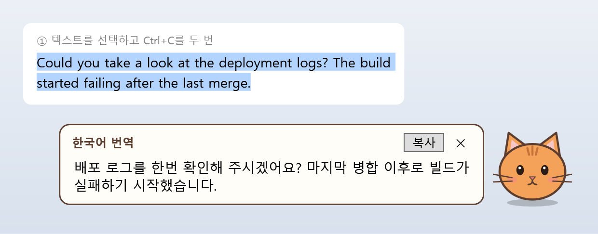
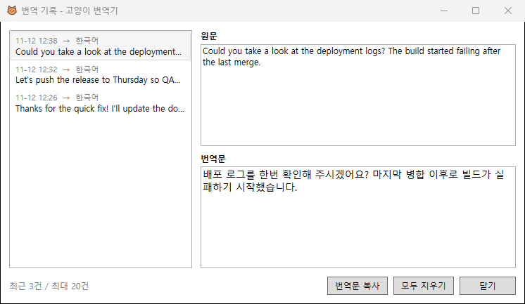

# Introduction

고양이 번역기는 한국어 번역을 빠르게 할 수 있는 Windows 용 데스크톱 앱입니다.

Ctrl + C 를 빠르게 두 번 누르면 동작합니다.



화면 한쪽에 떠 있는 고양이가 클립보드에 복사한 텍스트를 Claude API로 번역해서 말풍선으로 보여 줍니다. 클립보드를 기반으로 동작하므로 슬랙, 브라우저, 메신저 등 텍스트를 복사할 수 있는 프로그램이라면 별도 설정 없이 사용할 수 있습니다.

- **빠른 번역**: Ctrl+C 두 번, 고양이 클릭, 단축키(`Ctrl+Alt+T`) 중 편한 방법으로 번역합니다.
- **언어 선택**: 고양이를 우클릭해서 번역할 언어를 고릅니다. 한국어, English, 日本語, 中文 등 10개 언어를 지원합니다.
- **번역 기록**: 최근 번역 20건을 다시 볼 수 있습니다.
- **비용 절감**: 최소한의 영어 프롬프트와 `claude-haiku-5-5` 모델을 사용합니다.
- **안전장치**: 복사한 텍스트에 들어 있는 지시문(프롬프트 주입)을 따르지 않고 번역만 합니다.

## Build

### 요구 사항

- Windows 10 또는 11
- [.NET 10 SDK](https://dotnet.microsoft.com/download/dotnet/10.0) (빌드할 때만 필요)

  ```powershell
  winget install Microsoft.DotNet.SDK.10
  ```

- 빌드한 exe를 실행하는 PC에는 .NET 10 Desktop Runtime이 필요합니다. SDK를 설치했다면 런타임도 함께 설치되어 있습니다.

### 로컬 빌드

```powershell
cd CatTranslator

# 개발 중 실행 (XAML과 C# 변경 사항이 바로 반영됨)
dotnet watch

# 단일 exe 만들기
dotnet publish -c Release -r win-x64 --self-contained false -p:PublishSingleFile=true
```

`dotnet publish`가 끝나면 `CatTranslator\bin\Release\net10.0-windows\win-x64\publish\CatTranslator.exe`가 생성됩니다. 이 파일 하나만 원하는 폴더로 옮겨서 실행하면 됩니다.

### GitHub Actions 빌드

[`.github/workflows/build.yml`](.github/workflows/build.yml) 워크플로가 다음 경우에 Windows 러너에서 exe를 빌드합니다.

| 트리거 | 결과 |
|---|---|
| `main` 또는 `master` 브랜치에 push, Pull Request | 빌드한 exe를 아티팩트(`CatTranslator-win-x64`)로 업로드 |
| `v`로 시작하는 태그 push (예: `v1.0.0`) | 빌드한 exe를 GitHub 릴리스에 첨부 |
| Actions 탭에서 수동 실행 (`workflow_dispatch`) | 빌드한 exe를 아티팩트로 업로드 |

빌드한 exe는 Actions 실행 결과 페이지의 **Artifacts**에서 내려받을 수 있습니다. 릴리스를 만들려면 다음과 같이 태그를 push합니다.

```powershell
git tag v1.0.0
git push origin v1.0.0
```

## Usage

### 1. 처음 실행: API 키 설정

처음 실행하면 설정 창이 자동으로 열립니다. Claude Console에서 발급한 API 키를 입력하고 **저장**을 누르세요.

키는 현재 Windows 사용자 계정으로만 복호화할 수 있도록 DPAPI로 암호화해서 저장합니다. 키를 저장하지 않고 `CLAUDE_API_KEY` 또는 `ANTHROPIC_API_KEY` 환경 변수로 지정해도 됩니다.

### 2. 번역하기

1. 번역할 텍스트를 선택합니다.
2. **Ctrl을 누른 채 C를 두 번** 누릅니다. 두 번 누르는 간격은 0.7초 이내여야 합니다.
3. 고양이 옆 말풍선에 번역문이 나타납니다. **복사**를 누르면 번역문이 클립보드에 복사되고, `✕`나 `Esc`를 누르면 말풍선이 닫힙니다.

Ctrl+C 대신 텍스트를 한 번 복사한 뒤 고양이를 클릭하거나 `Ctrl+Alt+T`를 눌러도 번역됩니다. 번역하는 동안에는 고양이 오른쪽 위에 `…` 표시가 깜박입니다.

### 3. 고양이 조작

| 동작 | 기능 |
|---|---|
| 클릭 | 클립보드 번역 |
| 드래그 | 고양이 이동 (위치는 다음 실행 때도 유지됨) |
| 우클릭 | 번역할 언어 선택, Ctrl+C 두 번 기능 켜기/끄기, 번역 기록, 설정, 종료 |

### 4. 번역 기록



우클릭 메뉴에서 **번역 기록**을 열면 최근 20건의 원문과 번역문을 볼 수 있습니다. **번역문 복사**로 번역문을 다시 복사할 수 있고, **모두 지우기**로 기록을 삭제할 수 있습니다.

### 5. 설정

| 항목 | 설명 |
|---|---|
| Claude API 키 | 입력란을 비워 두고 저장하면 기존 키를 그대로 유지합니다. |
| 모델 | 기본값은 `claude-haiku-5-5`입니다. |
| 번역 단축키 | 입력란을 클릭한 뒤 원하는 조합을 누릅니다. 다른 프로그램이 이미 사용 중인 조합이면 저장할 때 알려 줍니다. |
| Ctrl+C 두 번으로 번역 | 끄면 고양이 클릭과 단축키로만 번역합니다. |
| 번역 기록 저장 | 끄면 기록 파일을 삭제하고, 앱을 실행하는 동안에만 기록을 유지합니다. |

설정과 기록은 `%APPDATA%\CatTranslator\` 폴더의 `settings.json`, `history.json`에 저장됩니다.

### 6. ⚠ 경고 표시

다음 경우에는 말풍선과 기록에 ⚠ 경고가 붙습니다. 원문이 코드인 경우에도 경고가 뜰 수 있으므로 참고용으로만 보시면 됩니다.

- 번역문이 선택한 언어로 보이지 않는 경우
- 출력 길이 제한에 걸려 번역문이 잘린 경우
- 모델이 구분 태그를 직접 출력한 경우

### 7. 보안과 개인 정보

- **프롬프트 주입 방지**: 지시문은 system 프롬프트에만 두고, 복사한 텍스트는 `<src>` 태그 안에 데이터로만 전달합니다. 텍스트 안의 `<src`, `</src`는 무력화해서 태그를 벗어나지 못하게 합니다. 요청에 도구를 넣지 않으므로, 주입에 성공하더라도 모델은 텍스트를 출력하는 것 외에는 아무것도 할 수 없습니다.
- **비밀번호 보호**: 비밀번호 관리자는 복사한 비밀번호에 "모니터링 제외" 표시를 붙입니다. 이 표시가 있으면 Ctrl+C를 두 번 눌러도 번역하지 않습니다.
- **클립보드 읽기**: Ctrl+C를 한 번 누를 때는 클립보드 내용을 읽지 않습니다. 두 번 눌렀을 때만 내용을 읽어서 API로 보냅니다.

### 제한 사항

- 한 번에 최대 12,000자까지 번역할 수 있습니다.
- 클립보드에 복사한 텍스트만 번역할 수 있고, 이미지는 번역할 수 없습니다.
- 같은 내용을 두 번째로 복사할 때 클립보드를 다시 쓰지 않는 프로그램에서는 Ctrl+C 두 번이 동작하지 않습니다. 이때는 고양이를 클릭하세요.

## Project Structure

```
CatTranslator/
├─ App.xaml(.cs)            앱 시작, 중복 실행 방지
├─ CatWindow.xaml(.cs)      고양이 창: 클릭/드래그, 우클릭 메뉴, 단축키, Ctrl+C 두 번 감지
├─ BubbleWindow.xaml(.cs)   번역 결과 말풍선
├─ HistoryWindow.xaml(.cs)  번역 기록 창
├─ SettingsWindow.xaml(.cs) 설정 창
├─ Core/
│  ├─ Translator.cs         프롬프트, Claude API 호출, 주입 방지, 출력 검사
│  ├─ Languages.cs          번역 언어 목록
│  ├─ SettingsStore.cs      설정 저장, API 키 암호화(DPAPI)
│  └─ HistoryStore.cs       최근 20건 기록
├─ Platform/                Win32 연동 (전역 단축키, 클립보드, 모니터 작업 영역)
└─ Assets/cat.ico           앱 아이콘
```

## License

[MIT](LICENSE)
